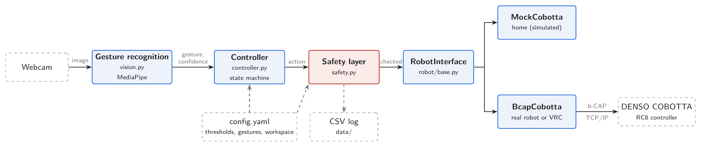
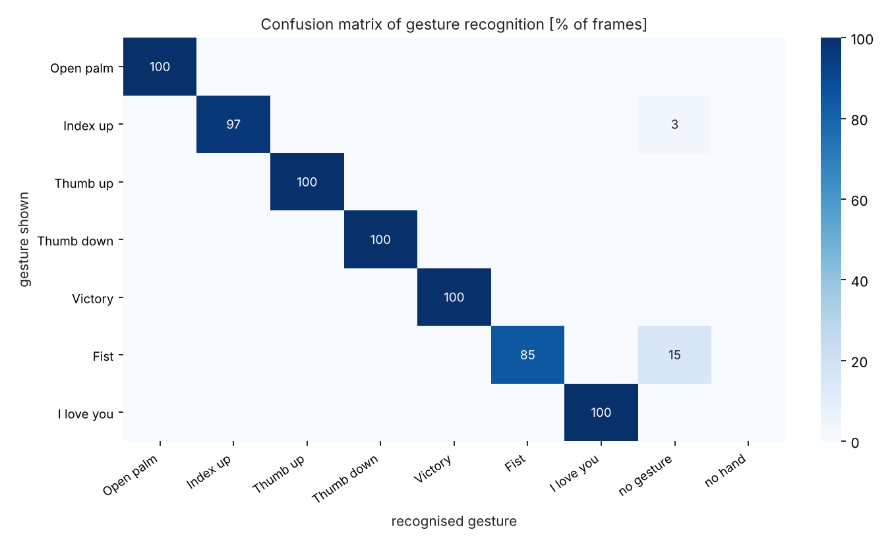
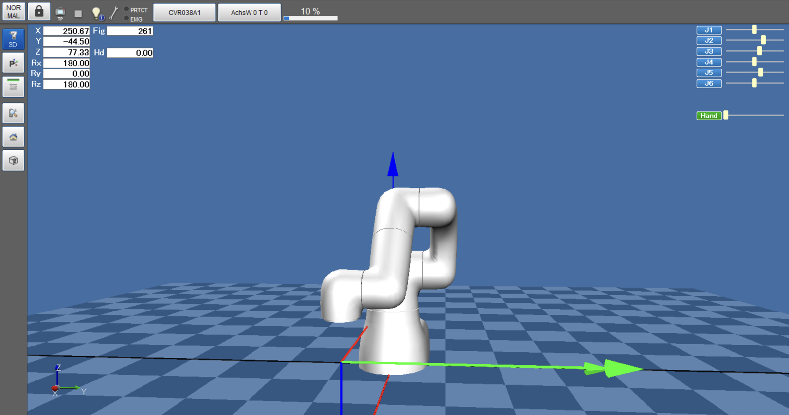
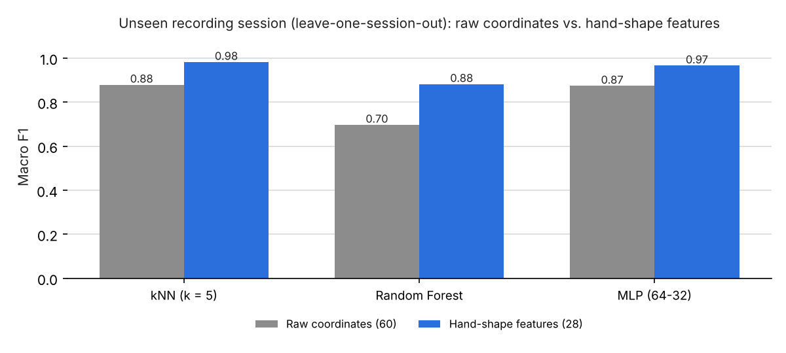

# Gesture Control for a DENSO COBOTTA

**English** | [Deutsch](#deutsch)

Hand-gesture control of a **DENSO COBOTTA** collaborative robot using a standard webcam.
Seven hand gestures are recognised with MediaPipe and turned into safe jog commands,
similar to jogging with an industrial teach pendant: select an axis, then step + or −.
As an alternative to MediaPipe's built-in gesture classifier, a **self-trained classifier**
(own dataset, hand-shape features, kNN) can be switched on.
University project in *Factory Automation & Robotics* (Westfälische Hochschule, Germany).

> **Status:** software, automated tests, recognition evaluation and own classifier are complete.
> The full chain has been validated against DENSO's virtual robot controller (VRC).



## Features

- **7 gestures** (MediaPipe pre-trained): open palm = stop, fist = enable, index up = switch axis X→Y→Z,
  thumb up/down = step +/−, "I love you" sign = coarse/fine step (5 mm / 1 mm), victory = gripper
- **Multi-layer safety concept**
  - starts in a stopped state; motion only after a deliberate enable gesture (fist held ~1 s)
  - stop gesture has top priority and a lower confidence threshold (fail-safe: a false stop is harmless, a missed stop is not)
  - automatic stop when no hand is visible for more than 1 s; re-enable required after every stop
  - commands only after stable recognition (5 consecutive frames)
  - independent safety layer checks every action: enable state, max. step size, workspace limits
  - reduced robot speed (10 %); the robot's hardware emergency stop always takes precedence
- **Own gesture classifier (optional):** replaces MediaPipe's last stage (hand points → gesture) with a
  model trained on a self-recorded dataset; selected in `config.yaml` (`erkennung.backend: eigen`)
- **Swappable robot backend:** simulated robot for development, real COBOTTA via DENSO's b-CAP protocol
- **Everything configurable** in `config.yaml` (thresholds, gestures, step sizes, workspace, robot IP)

## Results (gesture recognition, MacBook webcam)

| Metric | Result |
|---|---|
| Recognition rate (1,416 frames, 4 lighting/distance conditions + 1 repeat) | **97.0 %** |
| Confusions between gestures | **0** – every miss was "no gesture", so no action was triggered |
| Correct command triggered (35 recordings) | 34 / 35, **0 wrong commands** |
| Unintended motion commands during 60 s of free hand movement | **0** (16 harmless stops) |
| Time to trigger: stop / motion command | ~60–70 ms / ~210–270 ms |
| Recognition time per frame | 12.9 ms mean (camera runs at 15–30 fps) |
| Automated tests of state machine and safety layer | **21 / 21 passed** |
| Automated tests of the classifier features | **11 / 11 passed** |



## Validation in DENSO's robot simulation (VRC)

The unchanged control software ran on the Mac and drove a simulated COBOTTA in DENSO's virtual
robot controller (VRC, Windows VM) over b-CAP. Only the IP address differs from the real robot.

| Metric (2 runs, 7.3 min, 322 actions) | Result |
|---|---|
| Executed steps exactly 5 mm / 1 mm (all axes, both directions) | **236 / 236** |
| Stop gesture → robot halted | **35 ms** median (during a running step: after that step, ≤ 0.58 s) |
| Steps rejected at the workspace limits (X, Y, Z) | **33** |
| Unintended commands during random hand movement | **0** |
| Duration of one step at 10 % speed | 0.58 s (5 mm), 0.26 s (1 mm) |

Two bugs were found in the simulation: a wrong b-CAP provider name, and DENSO's
pass-motion option `@P`, which reported a step as finished after only 2.9 of 5 mm (fixed with `@E`).



## Own classifier vs. MediaPipe

MediaPipe still finds the hand and its 21 landmarks; only the final decision "which gesture is this?"
is made by a self-trained model.

- **Dataset:** 7,856 frames recorded with a guided script, 8 classes (7 gestures + *no command gesture*,
  so that a relaxed hand triggers nothing), 3 training sessions (bright 50 cm, bright 100 cm, dim)
  and a separate test session at a different time and place
- **Shortcut found and fixed:** with raw landmark coordinates every model scored 0.997 within the
  recordings but only 0.70–0.88 on an unseen session. The model had learned the hand's tilt towards
  the camera instead of the finger posture. **28 hand-shape features** (joint angles, normalised
  distances, direction in the image plane) fixed this.
- **Honest validation:** consecutive frames are almost identical, so models are compared with
  leave-one-session-out cross-validation instead of random splits; the test session is only used once
  at the end
- **Models compared:** kNN, Random Forest, MLP (scikit-learn); kNN selected by cross-validation

| | Own model (kNN) | MediaPipe |
|---|---|---|
| Macro F1, unseen training session (leave-one-session-out) | **0.982** | – |
| Test session: frame accuracy | **100 %** | 99.7 % |
| Test session: command gesture detected while showing *no gesture* | **0 %** | 2.2 % |
| Test session: correct command triggered by the controller | 7 / 7 | 7 / 7 |
| Inference time per frame (MacBook Air M3) | 0.3 ms | – |



Limitation: trained on one person's hands only; MediaPipe (trained on many people) remains the default.

## Tech stack

Python 3.11 · MediaPipe · OpenCV · scikit-learn · NumPy · Matplotlib · DENSO b-CAP (TCP/IP)

## Quick start

```bash
git clone https://github.com/AbhinavSridhar18/gesture-control-cobotta.git
cd gesture-control-cobotta
python3.11 -m venv .venv
source .venv/bin/activate
pip install -r requirements.txt

python gesture_demo.py             # gesture recognition only
python main.py                     # full gesture control (simulated robot by default)
python scripts/test_steuerung.py   # automated tests

# own classifier: record dataset, train, compare with MediaPipe
python scripts/aufnahme_datensatz.py --sitzung train_hell_50cm
python scripts/training_klassifikator.py
```

To use the own classifier, set `erkennung.backend: eigen` in `config.yaml`.

To drive DENSO's simulation (VRC + bCapListener in Windows): `python main.py --roboter bcap --ip <IP of the Windows machine>`.
For the real robot: `python main.py --roboter bcap` (IP from `config.yaml`; see the German section for commissioning).

## Project structure

| Path | Content |
|---|---|
| `src/vision.py` | camera + MediaPipe gesture recognition |
| `src/klassifikator.py` | hand-shape features + own classifier |
| `src/controller.py` | state machine: gesture → action |
| `src/safety.py` | independent safety layer |
| `src/robot/` | robot interface, simulated robot, real COBOTTA via b-CAP |
| `scripts/` | automated tests, recording and analysis of the evaluation, dataset recording and training |
| `data/datensatz/` | self-recorded dataset (hand landmarks only, no images) |
| `docs/` | evaluation results, full documentation and presentation (German); `docs/en/` English figures for this README |

Code comments and the full project documentation are in German, as submitted for the university module.

## Credits

The b-CAP client in `third_party/bCAPClient/` is provided by DENSO WAVE under the MIT license
([DENSORobot/orin_bcap](https://github.com/DENSORobot/orin_bcap)).

Author: Abhinav Sridhar

---

<a name="deutsch"></a>

# Gestensteuerung für einen DENSO COBOTTA (Deutsch)

Projektarbeit im Modul *Fabrikautomatisierung und Robotik* (Westfälische Hochschule).
Eine Webcam erkennt Handgesten (MediaPipe). Diese werden in sichere Bewegungsbefehle
für einen DENSO COBOTTA umgesetzt: an einem Mock-Roboter oder über b-CAP an der
DENSO-Steuerung (virtuell oder real).

## Architektur

```
Webcam -> Gestenerkennung -> Steuerung (Zustandsautomat) -> Sicherheitsschicht -> RobotInterface
          (MediaPipe)                                                              ├─ MockCobotta (zu Hause)
                                                                                   └─ BcapCobotta (b-CAP)
```

## Gestenset

| Geste             | Befehl                                   |
|-------------------|------------------------------------------|
| Offene Hand       | STOPP (höchste Priorität)                |
| Zeigefinger oben  | Achse wechseln X → Y → Z                 |
| Daumen hoch       | Schritt + auf der aktiven Achse          |
| Daumen runter     | Schritt − auf der aktiven Achse          |
| I-love-you-Zeichen 🤟 | Schrittweite umschalten 5 mm ↔ 1 mm (Grob-/Feinschritt) |
| Victory-Zeichen   | Greifer öffnen/schließen                 |
| Faust (halten)    | Freigabe nach Start und nach jedem STOPP |

Bedienkonzept: wie das Tippen am industriellen Teach Pendant – zuerst die Achse wählen,
dann mit + / − verfahren. Die aktive Achse wird in der in Robotik und CAD üblichen Farbkonvention
angezeigt: **X = rot, Y = grün, Z = blau**. Standardmäßig ordnet der vortrainierte
MediaPipe-Klassifikator die Gesten zu; alternativ ein eigener Klassifikator (siehe unten).

## Sicherheitskonzept

- Start im Zustand GESTOPPT; Bewegungen erst nach Freigabe (Faust ca. 1 s halten)
- STOPP (offene Hand) hat höchste Priorität, reagiert nach 2 Bildern (gemessen ~70 ms) und hat eine niedrigere Konfidenzschwelle (0,45): ein Fehlstopp ist harmlos, ein verpasster Stopp gefährlich (fail-safe)
- Keine Hand länger als 1 s sichtbar -> automatischer STOPP
- Nach jedem STOPP ist eine erneute Freigabe nötig (Quittierung)
- Befehle erst nach stabiler Erkennung (5 aufeinanderfolgende Bilder ≈ 230–270 ms, Konfidenz ≥ 0,55)
- Sicherheitsschicht prüft unabhängig von der Steuerung: Freigabe, maximale Schrittweite, Arbeitsraumgrenzen
- Reduzierte Geschwindigkeit am realen Roboter; der Not-Halt des COBOTTA bleibt jederzeit wirksam

## Einrichtung (macOS, Apple Silicon)

```bash
brew install python@3.11
cd ~/Desktop/Gestensteuerung_COBOTTA
python3.11 -m venv .venv
source .venv/bin/activate
pip install -r requirements.txt
```

## Ausführen

```bash
python gesture_demo.py              # nur Gestenerkennung (ohne Roboter)
python main.py                      # vollständige Gestensteuerung (Roboter laut config.yaml)
python scripts/test_steuerung.py    # automatischer Test von Steuerung + Sicherheitsschicht
python scripts/test_mock.py         # Test des Mock-COBOTTA + 3D-Bahnplot
python scripts/test_bcap_verbindung.py  # schrittweiser Verbindungstest (Simulation oder realer COBOTTA)
python scripts/test_klassifikator.py    # automatischer Test der Merkmale des eigenen Klassifikators
```

## Eigener Gestenklassifikator

MediaPipe liefert Hand und 21 Handpunkte; die Zuordnung zur Geste übernimmt ein selbst trainiertes
Modell (8 Klassen: 7 Gesten + „keine Befehlsgeste“, 28 Formmerkmale, kNN). Aktivieren mit
`erkennung -> backend: eigen` in `config.yaml`.

```bash
python scripts/aufnahme_datensatz.py --sitzung train_hell_50cm      # je Trainingssitzung
python scripts/aufnahme_datensatz.py --sitzung test_1 --dauer 6     # Testsitzung (anderer Ort/Zeitpunkt)
python scripts/training_klassifikator.py                            # Training, Vergleich mit MediaPipe, Bericht
python scripts/vergleich_merkmale.py                                # Rohkoordinaten vs. Formmerkmale
```

Ergebnis (`docs/auswertung/ergebnis_klassifikator.md`): Makro-F1 0,982 auf jeweils ungesehener
Trainingssitzung; Testsitzung 100 % (MediaPipe 99,7 %).

## Auswertung der Gestenerkennung (ohne Roboter)

```bash
python scripts/aufnahme_erkennung.py --bedingung hell_50cm      # je Geste 2 s Aufnahme, geführt
python scripts/aufnahme_erkennung.py --bedingung frei --fehlausloesung   # 60 s freie Handbewegung
python scripts/analyse_erkennung.py                             # Tabellen + Diagramme
python scripts/analyse_protokoll.py                                 # Auswertung der main.py-Protokolle
```

Empfohlen sind 4 Gesten-Durchläufe (hell/dunkel × 50/100 cm) und ein Fehlauslösungs-Test.
Ergebnis: `docs/auswertung/ergebnis_erkennung.md` mit Erkennungsrate je Geste und Bedingung,
Verwechslungsmatrix, Auslösezeit auf Befehlsebene, Rechenzeit pro Bild und Fehlauslösungen.
Vorher in macOS die Videoeffekte (Reaktionen, Center Stage, Porträt) ausschalten,
da sie direkt ins Kamerabild gezeichnet werden.

## Erprobung in der DENSO-Simulation (VRC)

Unter Windows (z. B. VM): DENSO ROBOTICS License Manager → VRC (Schlüssel im Installer) → WINCAPS III
aus dem vollständigen `Software`-Ordner (installiert ORiN2 mit bCapListener). Dann `TP.exe` mit
`Cobotta_test.WPJ` und `bCapListener.exe` starten, Port 5007 in der Firewall freigeben.
Lizenzschlüssel gehören nicht in das Repository.

```bash
nc -vz <IP> 5007                                   # Erreichbarkeit prüfen
python scripts/test_bcap_verbindung.py --ip <IP>   # schrittweiser Verbindungstest
python main.py --roboter bcap --ip <IP>            # Gestensteuerung
python scripts/analyse_protokoll.py data/protokoll_X.csv --titel "Simulation" --ausgabe ergebnis_simulation.md
```

Ergebnis (`docs/auswertung/ergebnis_simulation.md`): 236 von 236 Schritten exakt, Stopp nach 35 ms
(läuft gerade ein Schritt: erst nach diesem, bis 0,58 s), 33 Schritte an den Arbeitsraumgrenzen abgelehnt.

## Anbindung an einen realen COBOTTA

1. Laptop per Netzwerkkabel (ggf. USB-C-Ethernet-Adapter) mit der Steuerung verbinden.
2. Feste IP-Adresse am Laptop im Netz der Steuerung einstellen, z. B. `192.168.0.10`,
   Subnetzmaske `255.255.255.0` (Steuerung: `192.168.0.1`).
3. An der Steuerung prüfen: Ausführungsberechtigung (Executable Token) für Ethernet freigegeben.
4. Arbeitsraumgrenzen in `config.yaml` (`arbeitsraum`) an den realen Aufbau anpassen.
5. Falls ein elektrischer Greifer montiert ist: `greifer -> vorhanden: true`.
6. `python scripts/test_bcap_verbindung.py` ausführen (Schritt für Schritt, Hand am Not-Halt).
7. In `config.yaml` `roboter -> backend: bcap` setzen und `python main.py` starten.

Alle Einstellungen (Schwellwerte, Schrittweite, Arbeitsraum, Roboter-IP) stehen in `config.yaml`.

## Ordnerstruktur

```
config.yaml                    Einstellungen
main.py                        Hauptprogramm (Gestensteuerung)
gesture_demo.py                nur Gestenerkennung
src/vision.py                  Kamera + MediaPipe-Gestenerkennung
src/klassifikator.py           Formmerkmale + eigener Gestenklassifikator
src/controller.py              Zustandsautomat: Geste -> Aktion
src/safety.py                  Sicherheitsschicht
src/robot/base.py              abstrakte Roboter-Schnittstelle
src/robot/mock.py              Mock-COBOTTA (zu Hause)
src/robot/bcap_cobotta.py      realer COBOTTA über b-CAP
third_party/bCAPClient/        b-CAP-Client von DENSO WAVE (MIT-Lizenz, github.com/DENSORobot/orin_bcap)
scripts/                       Tests und Auswertung
data/                          Protokolldateien (CSV) jedes Durchlaufs
data/datensatz/                Datensatz des eigenen Klassifikators (nur Handpunkte)
models/  docs/
```

## Stand

- [x] Projektgerüst, Konfiguration, Roboter-Schnittstelle, Mock-Roboter
- [x] Live-Gestenerkennung (MediaPipe)
- [x] Steuerung (Zustandsautomat) + Sicherheitsschicht, automatisch getestet
- [x] b-CAP-Backend für den realen COBOTTA
- [x] Erprobung mit der DENSO-Simulation (VRC): Verbindung, Gestensteuerung, Auswertung
- [x] Auswertungsskripte für die Gestenerkennung (Aufnahme + Analyse)
- [x] Aufnahmen durchgeführt und ausgewertet (docs/auswertung/)
- [x] Projektdokumentation (docs/dokumentation/, LaTeX -> PDF) und Präsentation (docs/praesentation/)
- [x] Eigener Gestenklassifikator: Datensatz, Training, Vergleich mit MediaPipe

## Mögliche Erweiterungen (Ausblick)

- Zusätzliche Gesten mit dem eigenen Klassifikator (z. B. Orientierung), Aufnahmen weiterer Personen
- Redundante Stopp-Erkennung: Stopp, sobald MediaPipe oder das eigene Modell die offene Hand erkennt
- Asynchrone Bewegung mit sofortigem Abbruch während eines Schritts
