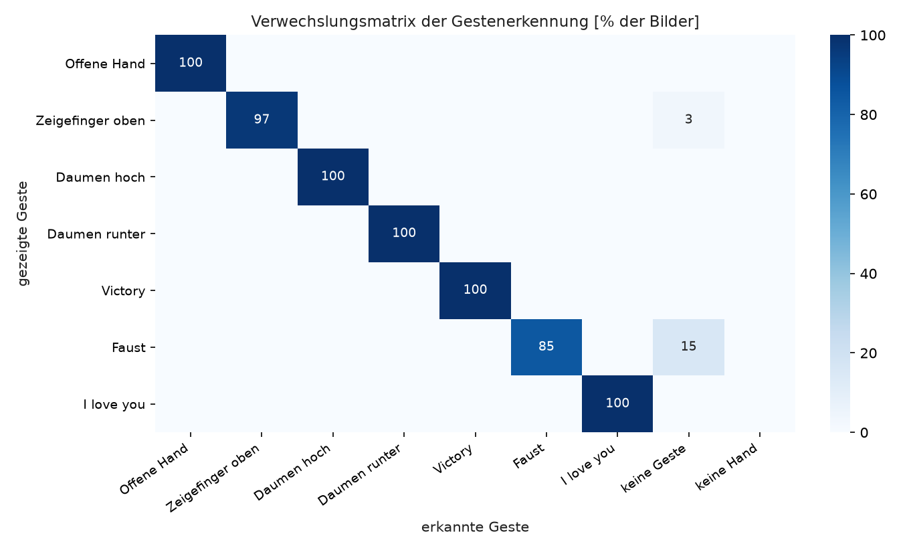
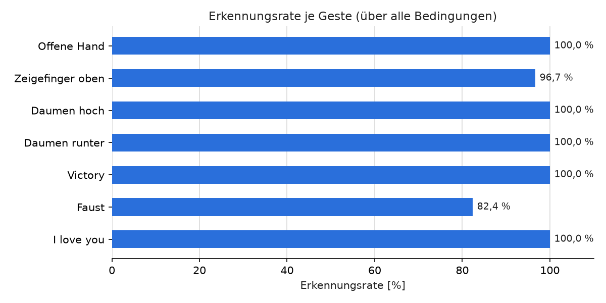

# Auswertung der Gestenerkennung

Datengrundlage: 1416 Bilder aus 5 Aufnahmen, Bedingungen: dunkel_100cm, dunkel_50cm, hell_100cm, hell_50cm, hell_50cm_wdh.  
Schwellen laut config.yaml: Bewegungsgesten ≥ 0,55, STOPP ≥ 0,45.

## 1. Erkennungsrate je Geste (Bildebene)

Anteil der Bilder, in denen die richtige Geste mit ausreichender Konfidenz erkannt wurde.

| Geste | Bilder | Erkennungsrate | mittlere Konfidenz (richtig erkannt) |
|---|---:|---:|---:|
| Offene Hand | 181 | 100,0 % | 0,62 |
| Zeigefinger oben | 180 | 96,7 % | 0,80 |
| Daumen hoch | 211 | 100,0 % | 0,67 |
| Daumen runter | 211 | 100,0 % | 0,91 |
| Victory | 212 | 100,0 % | 0,86 |
| Faust | 210 | 82,4 % | 0,81 |
| I love you | 211 | 100,0 % | 0,76 |
| **gesamt** | 1416 | **97,0 %** | |

## 2. Erkennungsrate je Bedingung

| Geste | dunkel_100cm | dunkel_50cm | hell_100cm | hell_50cm | hell_50cm_wdh |
|---|---:|---:|---:|---:|---:|
| Offene Hand | 100,0 % | 100,0 % | 100,0 % | 100,0 % | 100,0 % |
| Zeigefinger oben | 100,0 % | 100,0 % | 83,9 % | 100,0 % | 98,3 % |
| Daumen hoch | 100,0 % | 100,0 % | 100,0 % | 100,0 % | 100,0 % |
| Daumen runter | 100,0 % | 100,0 % | 100,0 % | 100,0 % | 100,0 % |
| Victory | 100,0 % | 100,0 % | 100,0 % | 100,0 % | 100,0 % |
| Faust | 100,0 % | 100,0 % | 100,0 % | 38,3 % | 100,0 % |
| I love you | 100,0 % | 100,0 % | 100,0 % | 100,0 % | 100,0 % |

## 3. Verwechslungsmatrix

Zeilen: gezeigte Geste, Spalten: von MediaPipe erkannte Geste (Anteil der Bilder, ohne Schwelle).

Fehlerarten: Von 43 nicht erkannten Bildern waren 43 (100,0 %) "keine Geste", "keine Hand" oder richtige Geste unter der Schwelle (sicherer Fehlerfall: keine Aktion) und 0 (0,0 %) eine andere Geste (Verwechslung).

## 4. Befehlsebene (Simulation durch die Steuerung)

Jede Aufnahme wird durch den Zustandsautomaten gespielt (Faust: Start im Zustand GESTOPPT, sonst BEREIT). Ausgewertet: richtiger Befehl ausgelöst, Zeit bis zur ersten Auslösung, falsche Befehle. Die Auslösezeit zählt ab dem ersten aufgenommenen Bild (die Geste wird bereits gezeigt) und enthält damit die Entprellung durch die Steuerung, nicht die Bewegung der Hand.

| Geste | Aufnahmen | richtiger Befehl ausgelöst | mittlere Auslösezeit | falsche Befehle |
|---|---:|---:|---:|---:|
| Offene Hand | 5 | 5 / 5 | 60 ms | 0 |
| Zeigefinger oben | 5 | 5 / 5 | 239 ms | 0 |
| Daumen hoch | 5 | 5 / 5 | 213 ms | 0 |
| Daumen runter | 5 | 5 / 5 | 213 ms | 0 |
| Victory | 5 | 5 / 5 | 214 ms | 0 |
| Faust | 5 | 4 / 5 | 816 ms | 0 |
| I love you | 5 | 5 / 5 | 214 ms | 0 |

## 5. Rechenzeit der Gestenerkennung pro Bild

| Mittelwert | Median | 95-%-Quantil | Maximum |
|---:|---:|---:|---:|
| 12,9 ms | 14,1 ms | 14,9 ms | 27,9 ms |

Gemessene Bildrate der Kamera: Median 15,0 Bilder/s (Bereich 15,0 bis 30,0 Bilder/s; die Belichtungsautomatik senkt die Bildrate bei wenig Licht). Die Bildrate wird durch die Kamera begrenzt, nicht durch die Erkennung.

Daraus folgende Entprellzeiten: Bewegungsbefehle 5 Bilder ≈ 266 ms, STOPP 2 Bilder ≈ 67 ms, Freigabe 15 Bilder ≈ 933 ms.

## 6. Fehlauslösungen bei freier Handbewegung

| Aufnahme | Dauer | Bewegungsbefehle | sonstige Befehle | Stopps (harmlos) |
|---|---:|---:|---:|---:|
| frei | 60 s | 0 | 0 | 16 |

Annahme ungünstigster Fall: das System ist während der gesamten Aufnahme freigegeben.
