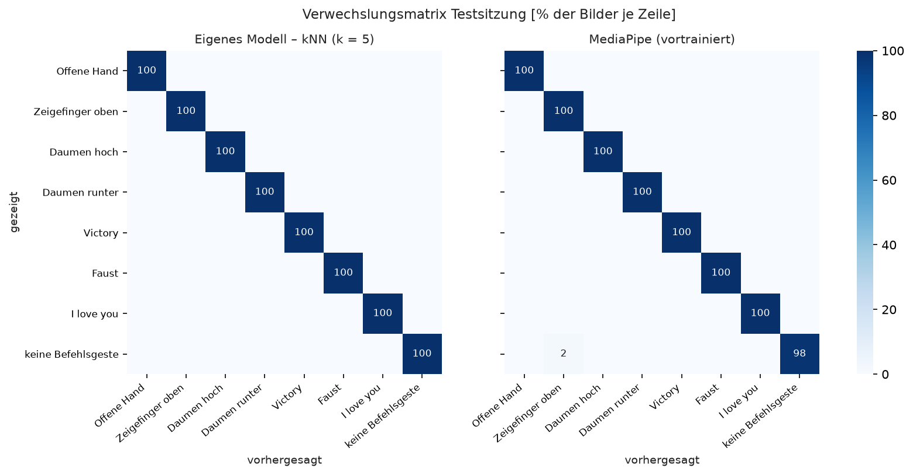
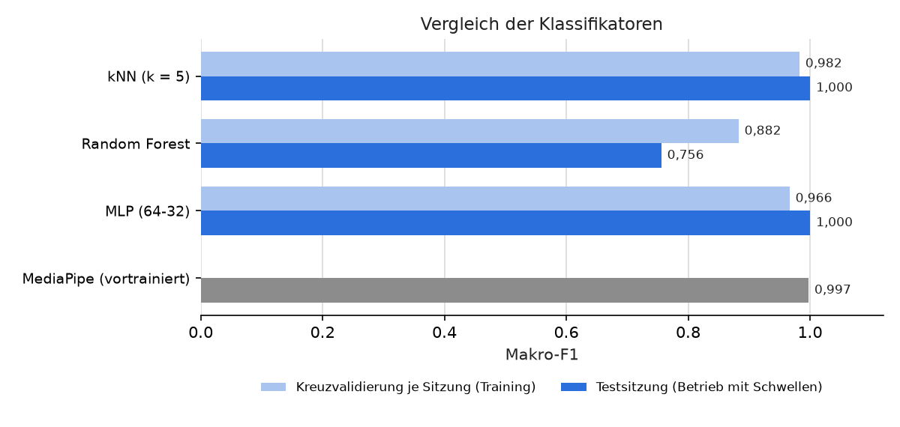

# Eigener Gestenklassifikator – Ergebnis

Erstellt: 27.10.2026 18:04  
Merkmale: 28 Formmerkmale aus den 21 MediaPipe-Handpunkten (15 Beugewinkel, 9 normierte Abstände, Richtung von Hand und Daumen in der Bildebene).  
Klassen: 7 Befehlsgesten + „keine Befehlsgeste“ (Other).

## 1. Datensatz

| Sitzung | Verwendung | Bilder mit Hand |
|---|---|---:|
| test_1 | Test | 728 |
| train_dunkel | Training | 2380 |
| train_hell_100cm | Training | 2382 |
| train_hell_50cm | Training | 2366 |

| Klasse | Training | Test |
|---|---:|---:|
| Offene Hand | 894 | 90 |
| Zeigefinger oben | 881 | 95 |
| Daumen hoch | 877 | 90 |
| Daumen runter | 896 | 90 |
| Victory | 895 | 92 |
| Faust | 898 | 90 |
| I love you | 888 | 91 |
| keine Befehlsgeste | 899 | 90 |

## 2. Kreuzvalidierung auf den Trainingsdaten

| Verfahren | Makro-F1 je Sitzung (train_dunkel, train_hell_100cm, train_hell_50cm) | Mittelwert | zum Vergleich: 2-s-Abschnitte | Rechenzeit je Bild |
|---|---|---:|---:|---:|
| kNN (k = 5) **(ausgewählt)** | 0,997, 0,978, 0,972 | **0,982** | 0,994 | 0,30 ms |
| Random Forest | 0,996, 0,845, 0,806 | **0,882** | 0,997 | 3,91 ms |
| MLP (64-32) | 0,998, 0,982, 0,918 | **0,966** | 0,994 | 0,13 ms |

Kreuzvalidierung je Sitzung: trainiert auf allen Sitzungen außer einer, bewertet auf der ausgelassenen. Die Kreuzvalidierung über 2-s-Abschnitte innerhalb der Aufnahmen kann zu optimistisch sein, da Licht, Abstand und Handhaltung innerhalb einer Aufnahme nahezu gleich bleiben; ausgewählt wird daher nach der Kreuzvalidierung je Sitzung.

## 3. Testsitzung – Bildebene (gleiche Bilder, Schwellen aus config.yaml)

| Verfahren | Genauigkeit | Makro-F1 | falsche Befehlsgeste | Befehlsgeste verpasst (sicher) | Befehlsgeste bei „keine Geste“ |
|---|---:|---:|---:|---:|---:|
| kNN (k = 5) **(ausgewählt)** | 100,0 % | 1,000 | 0,00 % | 0,0 % | 0,0 % |
| Random Forest | 78,6 % | 0,756 | 0,00 % | 24,5 % | 0,0 % |
| MLP (64-32) | 100,0 % | 1,000 | 0,00 % | 0,0 % | 0,0 % |
| MediaPipe | 99,7 % | 0,997 | 0,27 % | 0,0 % | 2,2 % |

*falsche Befehlsgeste*: andere Befehlsgeste als gezeigt (Anteil aller Bilder); *verpasst*: Befehlsgeste gezeigt, aber „keine Geste“ erkannt (sicherer Fehlerfall); *bei „keine Geste“*: Anteil der Other-Bilder mit erkannter Befehlsgeste.

## 4. Testsitzung – Steuerungsebene (Zustandsautomat wie im Betrieb)

| Verfahren | richtiger Befehl ausgelöst | Befehle bei „keine Geste“ (ohne STOPP) | STOPP bei „keine Geste“ |
|---|---:|---:|---:|
| kNN (k = 5) **(ausgewählt)** | 7 / 7 | 0 in 6 s | 0 |
| Random Forest | 6 / 7 | 0 in 6 s | 0 |
| MLP (64-32) | 7 / 7 | 0 in 6 s | 0 |
| MediaPipe | 7 / 7 | 0 in 6 s | 0 |

### Erkennungsrate je Klasse (Testsitzung, Bildebene)

| Klasse | Eigenes Modell (kNN (k = 5)) | MediaPipe |
|---|---:|---:|
| Offene Hand | 100,0 % | 100,0 % |
| Zeigefinger oben | 100,0 % | 100,0 % |
| Daumen hoch | 100,0 % | 100,0 % |
| Daumen runter | 100,0 % | 100,0 % |
| Victory | 100,0 % | 100,0 % |
| Faust | 100,0 % | 100,0 % |
| I love you | 100,0 % | 100,0 % |
| keine Befehlsgeste | 100,0 % | 97,8 % |

Hinweis: Auswahl des eigenen Verfahrens ausschließlich nach der Kreuzvalidierung, damit die Testsitzung eine unabhängige Bewertung bleibt. Der MediaPipe-Klassifikator wurde nicht mit diesen Daten trainiert.
